 

Sou estudante de Sistemas de Informação na Univale, em Governador Valadares/MG, e atuo como desenvolvedor full-stack júnior, principalmente com PHP, Laravel, Blade e React Native.

Este perfil é o meu espaço de estudo: experimentos, automações pequenas e projetos paralelos. Aprendo fazendo, quebrando e consertando.

 

