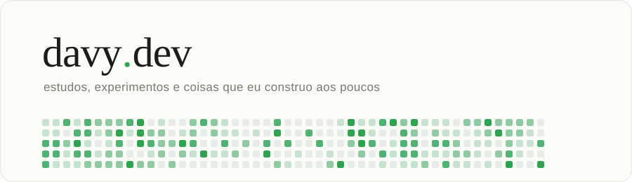

  

 

### sobre

Este é o meu cantinho pessoal. Aqui eu guardo estudos, testes e projetos paralelos, sem pressa e sem pressão de entrega. Aprendo fazendo, quebro, conserto e anoto o que descobri.

### no momento

- estudando e praticando um pouco todo dia
- montando automações pequenas para facilitar a rotina
- organizando minhas anotações e projetos em um só lugar

### ferramentas

 

feito com calma · atualizado quando dá
